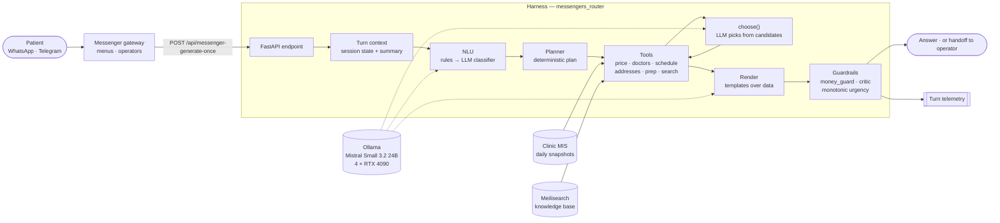

# Distributed Local AI Agent

**A production LLM assistant for a network of medical clinics — self-hosted, data-grounded, and built so the model never invents a price, an address or a doctor.**

[](https://github.com/Maytereya/Distributed-Local-AI-Agent/actions/workflows/tests.yml)


Patients write to the clinic in WhatsApp and Telegram. The bot answers questions about prices, branch addresses,
test preparation, doctors and schedules, takes appointment requests, and hands the dialogue to a human operator
whenever it is not sure. It runs on the clinic's own GPU server: patient messages never leave the perimeter.

---

## Why it is built this way

A wrong price or a wrong address in a medical chat is worse than no answer. The architecture follows five rules
(`docs/ARCHITECTURE_PRINCIPLES.md`), and every fix in the bug log cites the rule it serves:

| # | Rule | In code |
|---|---|---|
| 1 | **Facts are printed by code from clinic data.** The LLM never writes a number, address or name in its own words | prebuilt templates over MIS snapshots; `money_guard.py` strips sums from free LLM text |
| 2 | **The LLM understands meaning by picking from candidates.** Rules and search propose, the model returns an index or "none fits" | `choice.py` — closed-set selection with a JSON Schema answer |
| 3 | **No data → an honest handoff to an operator**, not a made-up answer | `degradation.py`, handoff policies |
| 4 | **Safety is monotonic.** Any layer may raise urgency; no layer may lower it | urgent / complaint / medical-advice labels |
| 5 | **The bot always knows what answer it is waiting for** and never loops | `expects.py`, `pending_answer.py` |

## Architecture



**The key design decision:** the LLM does not drive the tool loop. A deterministic planner chooses the tools; the model
works *inside* the steps — it classifies intent and selects from a numbered list of real catalogue rows. It cannot
name a service that is not in the clinic's price list.

## LLM Ops

| Stage | How |
|---|---|
| **Trace** | `turn_telemetry.py` — one JSON line per turn: where the answer came from, who decided the intent (rule or LLM), every LLM call with outcome, latency, queue wait and tokens. No personal data |
| **Eval** | `evalbench/` — a golden set replayed through the real endpoint in a *frozen world* (fixed MIS snapshot, cached LLM answers), so two code versions are compared fairly. A run with `valid=false` is rejected |
| **Gate** | `ruff` + ~6,800 hermetic tests in parallel (`pytest -n auto`, ~3.5 min). Network access is blocked inside tests. CI also checks import boundaries and a *rules ratchet*: the number of regexes and stop-word lists may only go down |
| **Release** | every new LLM layer ships behind a switch: `off` → `shadow` (computed in parallel, logged, not shown to the patient) → `on` |
| **Diagnose** | `docs/messengers_router_bug_log.md` — symptom · root cause · fix · **class invariant** · coverage. Tests are written for the class of failure, not for one phrase |

## Stack

| Layer | Technology |
|---|---|
| API | Python 3.12, FastAPI, Pydantic, httpx, asyncio |
| LLM | Ollama (self-hosted), Mistral Small 3.2 24B fp16 on 4 × RTX 4090; structured output via JSON Schema |
| Retrieval | Meilisearch (full-text, typo-tolerant — better than embeddings for short medical names and abbreviations); ChromaDB for the staff assistant's document RAG |
| Data | Clinic MIS REST API → daily JSONL snapshots (prices, doctors, branches, service synonyms) |
| Admin UI | Gradio |
| Infra | Docker Compose, nginx |
| Quality | pytest + pytest-xdist, ruff, GitHub Actions |

## Repository map

| Path | What lives there |
|---|---|
| `messengers_router/` | the patient bot: endpoint, orchestrator, NLU, planner, guardrails, telemetry |
| `messengers_router/services/` | tools over clinic data: prices and basket, doctors, schedule, addresses, preparation |
| `messengers_router/prompts/` | one prompt per task (classifier, row selection, rendering, validators) |
| `agent_logic_2/nayka_api/` | MIS API client and snapshot loaders |
| `evalbench/` | offline evaluation bench and comparison card |
| `tests/` | hermetic test suite; `tests/test_*_class.py` hold class-level invariants |
| `docs/ARCHITECTURE_PRINCIPLES.md` | the five rules above |
| `src/localragagent/` | FreeTalk — a separate free-form agent subsystem with its own maintainer |

## Running locally

```bash
python3.12 -m venv venv
./venv/bin/pip install -r requirements.txt -r requirements-ci.txt

# tests (hermetic: no network, no LLM needed)
./venv/bin/ruff check messengers_router tests
./venv/bin/python -m pytest -q -n auto

# API (needs agent_logic_2/config.ini — not tracked; keys and defaults are in agent_logic_2/config.py)
./venv/bin/uvicorn agent_api:app --port 8000
```

```bash
curl -s localhost:8000/api/messenger-generate-once \
  -H 'Content-Type: application/json' \
  -d '{"session_id": "demo", "text": "сколько стоит общий анализ крови"}'
```

## Known limitations

This is a living production system, and the debt is tracked openly:

- The NLU still has a rule layer from the early versions. It is being replaced topic by topic with closed-set LLM
  selection; the rules ratchet in CI keeps it from growing.
- Sessions live in process memory: a container restart drops open dialogues.
- New behaviour is introduced behind switches; once a switch has been `on` for a week, its `off` path is deleted.

## License

Apache 2.0 — see [LICENSE](LICENSE).
